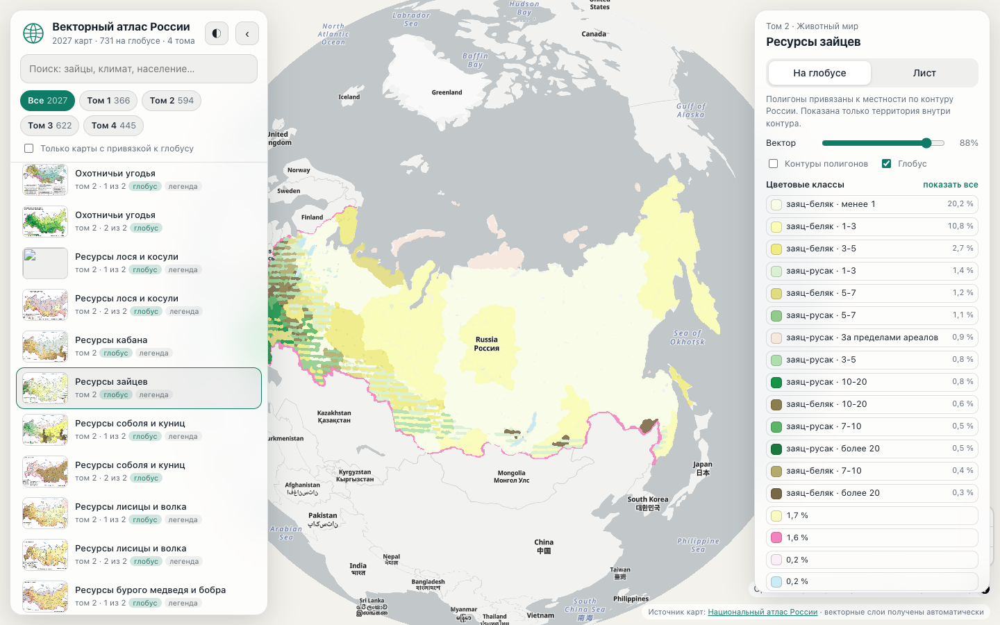
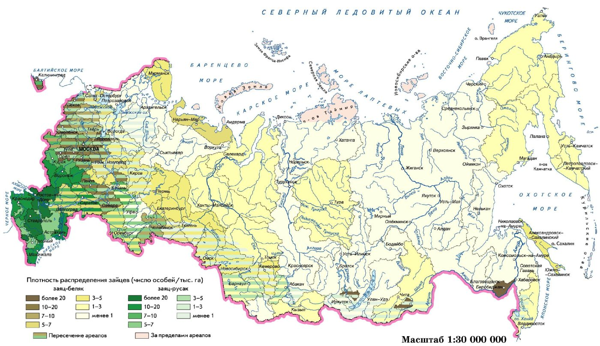
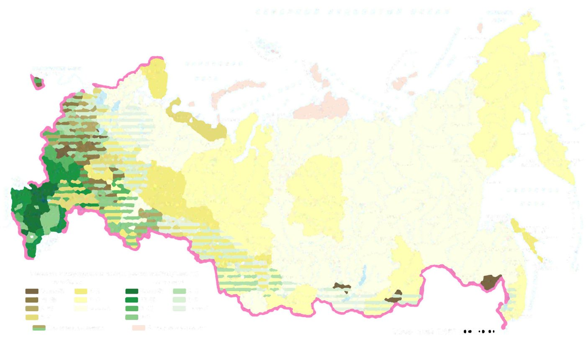
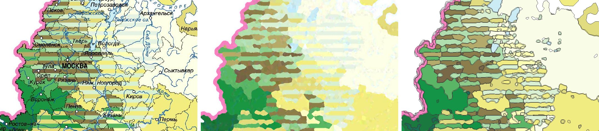
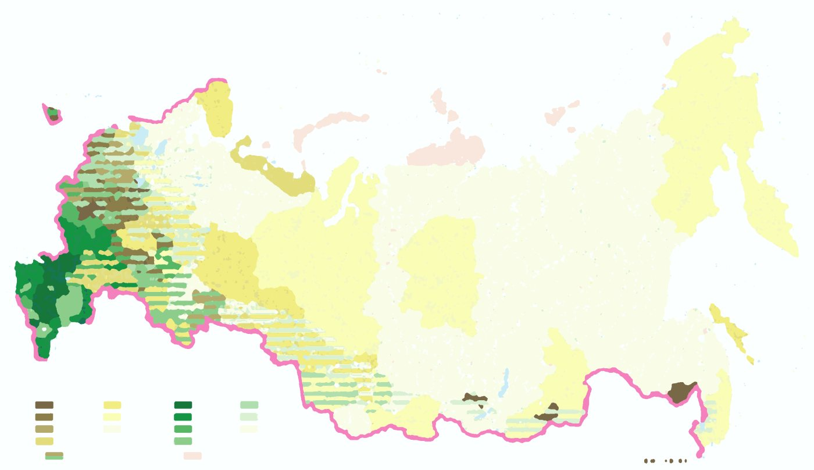
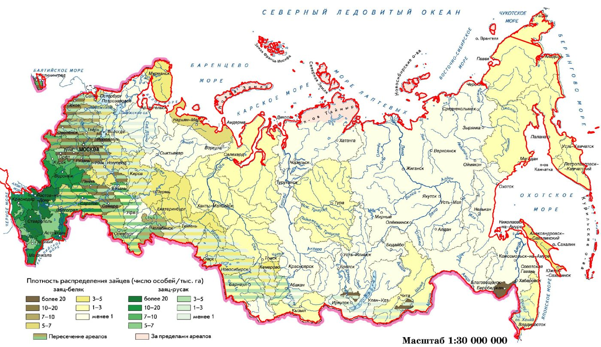
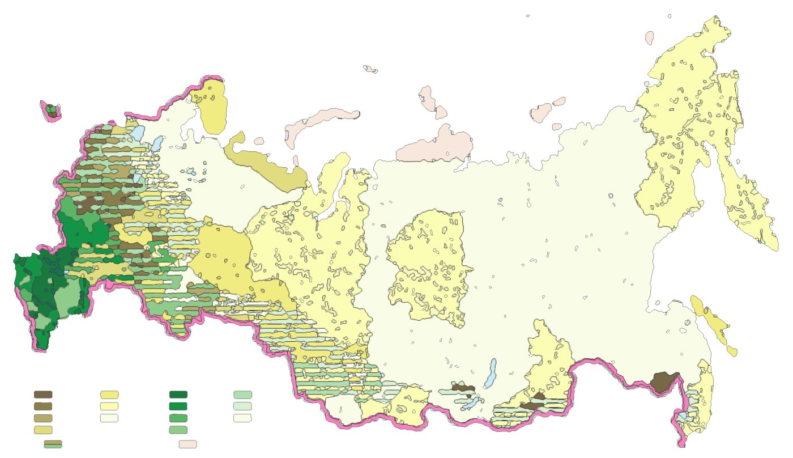

# Векторный атлас России

Проект переводит карты [Национального атласа России](https://nationalatlas.ru) из
растровых картинок в векторные полигоны. Сайт показывает полигоны на интерактивном глобусе.

Сайт: **https://atlas.ebpm.center**



## Результат

| Показатель | Значение |
|---|---|
| Карты в атласе | 2027 |
| Карты с векторным слоем | 1900 |
| Листы только как картинка | 127 |
| Карты на глобусе | 731 |
| Карты с подписями классов | 746 |
| Карты с классами по легенде | 167 |

Карта с векторным слоем имеет на сайте 4 части:

- векторный слой
- оригинальное изображение для скачивания
- файл GeoJSON для скачивания
- ссылку на страницу-источник

Лист без векторного слоя сайт показывает как картинку. Оригинал и ссылка на источник
у такого листа тоже есть.

## Путь от картинки к карте

Пример — карта [«Ресурсы зайцев»](https://nationalatlas.ru/tom2/383.html) из тома 2.
Идентификатор карты: `2-383-1`. Код каждого шага лежит в папке `pipeline/`.

### Шаг 0. Сбор изображений

Программа `crawl.py` обходит страницы 4 томов от оглавлений и сохраняет HTML на диск.
Программа `catalog.py` выбирает из страниц изображения с атрибутом `data-zoom-image`.
Это версии высокого разрешения: до 2900 × 4000 пикселей. Сайт-источник показывает их под
лупой. Для каждого изображения программа записывает том, раздел и название страницы.

Программа `download.py` скачивает файлы в 5 потоков. Она пропускает файлы, которые уже
есть на диске.



### Шаг 1. Удаление подписей, рек и линий

Подписи городов, реки и границы регионов закрывают цветовую заливку. Если пропустить этот
шаг, каждая буква станет отдельным полигоном.

Функция `vec.clean` делает 4 действия:

1. Операция black-hat находит штрихи, которые темнее окружения и уже 7 пикселей.
   Операция top-hat находит штрихи, которые светлее окружения.
2. Функция помечает найденные пиксели как «чернила» и расширяет маску на 1 пиксель.
   Расширение захватывает сглаженные края букв.
3. Каждый пиксель «чернил» получает цвет ближайшего чистого пикселя.
4. Медианный фильтр 5 × 5 убирает остатки шума.

Ширина ядра — 7 пикселей. При этой ширине подписи и реки исчезают. Полосы штриховки
шириной от 8 до 10 пикселей остаются.



Фрагмент крупно: оригинал, результат очистки, итоговые полигоны.



### Шаг 2. Цветовые классы

Функция `vec.quantize` переводит цвета в пространство Lab. Расстояние между цветами в Lab
близко к разнице, которую видит глаз. Функция берёт 150 000 случайных пикселей и запускает
k-means с 32 центрами. Затем она объединяет центры, расстояние между которыми меньше
ΔE = 7. Классы с долей меньше 0,04 % функция отбрасывает. Каждый пиксель получает номер
ближайшего центра.



### Шаг 3. Сглаживание

Функция `vec.smooth_labels` делает 2 действия:

- Голосование в окне 5 × 5. Пиксель получает класс, который преобладает вокруг него.
  Это убирает одиночные пиксели на границах.
- Чистка мелких областей. Функция стирает связные области меньше 0,0012 % листа и меньше
  30 пикселей. Стёртые пиксели получают класс ближайшего соседа.

### Шаг 4. Привязка к местности

Задача шага: найти долготу и широту каждого пикселя. Атлас содержит 2000 карт, поэтому
ручная расстановка опорных точек не подходит. Привязка автоматическая и состоит из 2 частей.

**Часть 4а: проекция атласа.** Эту часть мы сделали 1 раз. На карте зайцев мы вручную
отметили 26 городов: пиксель и известные координаты. Программа `fit_ref.py` подогнала по
ним равнопромежуточную коническую проекцию. У проекции 7 параметров: постоянная конуса `n`,
радиус `G`, центральный меридиан, масштаб, сдвиг по 2 осям и поворот.

Медианная ошибка —
6 пикселей оригинала. При масштабе 1 : 30 000 000 это около 25 км. Параметры лежат в файле
`pipeline/ref.json`.

```
ρ = G − φ            θ = n · (λ − λ₀)
x = ρ · sin θ        y = −ρ · cos θ
X = tx + k · (x·cos r − y·sin r)
Y = ty − k · (x·sin r + y·cos r)
```

**Часть 4б: каждая карта.** Авторы атласа рисовали тематические карты на одной основе в
разных масштабах. Поэтому форма страны на этих картах одинакова. Функция `georef.fit`
проецирует контур России из набора Natural Earth и ищет его на изображении:

1. Детектор Канни находит границы на изображении по 3 цветовым каналам.
2. Функция относит каждую точку границы к 1 из 6 направлений по градиенту.
3. Грубый поиск: функция рисует контур в 34 масштабах и 5 поворотах. Для каждого варианта
   `matchTemplate` находит лучшее положение.
4. Сравнение идёт отдельно по направлениям. Северный берег должен совпасть с
   горизонтальной границей, а не с любой.
5. Симплекс-метод уточняет 6 лучших вариантов. Мера — расстояние от точки контура до границы
   того же направления с верхним пределом.
6. Побеждает вариант, у которого больше точек контура лежит на границах.
7. В конце функция немного меняет параметры самой проекции. Причина: проекции в томах
   слегка разные.

Первая версия не учитывала направление границ. На картах со штриховкой контур «прилипал»
к внутренним линиям, и проверка это пропускала. Учёт направления исправил ошибку.

**Порог качества.** Функция принимает привязку, если выполнены все 5 условий:

| Условие | Порог |
|---|---|
| Доля точек контура на границе того же направления | не меньше 0,70 |
| Превышение этой доли над случайным совпадением | не меньше 0,40 |
| Доля контура внутри изображения | не меньше 0,90 |
| Ширина контура относительно ширины листа | не меньше 0,68 |
| Отклонение поворота от эталона | не больше 0,14 рад |

Для насыщенных листов с рельефом второе условие мягче: 0,25. Это послабление действует,
если совпало 85 % точек и контур занимает больше 60 % ширины листа.

Карту, которая не прошла порог, сайт показывает только в режиме «лист». Порог отсекает
карты мира, региональные листы, графики и космоснимки. Константы порога стоят в начале
файла `georef.py`.



### Шаг 5. Полигоны

Функция `vec.polygons` строит бинарную маску для каждого класса. Операция `findContours`
получает из маски внешние контуры и отверстия. Алгоритм Дугласа — Пекера упрощает контуры
с допуском 0,9 пикселя.

Привязанную карту функция `vec.process` режет по контуру России. Каждый полигон получает
признак «внутри территории». Легенда, рамка и подпись масштаба остаются снаружи. На глобус
они не попадают.

Функция считает почти белый класс фоном и пропускает его. Условие: светлота L больше 96,5 при
малой насыщенности.

Предел размера файла — 1,4 МБ. Если файл больше, функция обрабатывает карту заново с
грубыми настройками: меньше классов, крупнее минимальная область. Так бывает с
топографическими листами и космоснимками.



### Шаг 6. Подписи классов из легенды

Цель шага: подсказка показывает смысл класса, а не код цвета. Пример: «заяц-беляк · 3–5».

1. Функция `legend.swatches` ищет образцы среди полигонов вне территории. Образец —
   почти прямоугольная область типичного размера. Если на листе есть 3 одинаковых
   образца или больше, функция берёт их.
2. Программа `ocr.swift` распознаёт текст листа через Apple Vision. Язык: русский.
   Apple Vision уменьшает большой лист и теряет мелкий текст. Поэтому программа
   `ocr_legends.py` читает легенду ещё раз: вырезает область каждой колонки образцов
   и увеличивает её в 2 раза. На карте `2-328-330-1` целый лист дал 70 строк текста,
   области легенды — 528 строк. Для легенды с образцами ниже 22 пикселей программа
   `build_legends.py` берёт второе чтение. Для крупной легенды она берёт второе чтение,
   только если оно нашло на четверть больше знаков.
3. Функция `legend.decode` собирает образцы в колонки по левому краю. Каждую строку текста
   справа от колонки функция относит к образцу, который ближе всех по высоте. Так функция
   держит строки переноса вместе с подписью.
4. Заголовок группы — строка над верхним образцом колонки или строка внутри колонки
   между двумя образцами.
5. Функция `legend.tidy` чистит подпись и исправляет буквы чужого алфавита, похожие
   по начертанию. Номер условного знака конвейер хранит отдельно.
6. Функция `legend.harmonise` исправляет редкое латинское слово по частому слову той же
   легенды. Пример: «Befula» среди многих «Betula».
7. Легенда часто печатает несколько знаков одним цветом и различает их номером на листе.
   Класс с 2–6 такими знаками получает список вариантов с номерами.

#### Классы по цветам легенды

Первый проход различает до 32 цветов. Для подробной карты этого мало: соседние цвета
легенды попадают в один класс. Конвейер сам находит такие карты и делает второй проход:
берёт цвет каждого образца легенды и строит классы по этим цветам.

Правило отбора: цветов в легенде больше, чем классов у её образцов после первого прохода.
Второй проход остаётся, если выполнены три условия (`legend.keeps_legend`, `build.by_legend`):

- образцов найдено не меньше 90 % от их числа в первом проходе
- классов у образцов стало больше
- лист не превратился в картинку по правилу `noise`

Итог: 167 карт с классами по легенде. Подписей и списков вариантов на них стало 1793,
было 1332. На карте растительности `2-328-330-1` классов 69 вместо 32. Море и соседние
страны теперь получают свой класс без подписи. Раньше они делили класс со знаком легенды
и показывали чужую подпись.

Цветовые классы воспроизводимы: `vec.quantize` задаёт начальное число генератора OpenCV.

Класс образца известен сразу: это класс его полигона.

Функция `legend.drop_junk` убирает мусор распознавания:

- подпись длиннее 120 знаков: это абзац текста рядом с образцом
- подпись без букв и цифр
- подпись, где больше четверти слов набраны буквами двух алфавитов
- подпись длиннее двух слов со строкой низкой уверенности распознавания
- подпись со строчной первой буквой в легенде, где остальные подписи начинаются
  с заглавной: у такой подписи потеряно начало

### Шаг 7. Показ в браузере

Конвейер хранит вектор в пикселях оригинала в компактном JSON. Средний размер файла —
около 300 КБ. Параметры привязки лежат в каталоге.

Браузер переводит пиксели в долготу и
широту обратной формулой проекции. Это функция `invProj` в файле `site/public/proj.js`.
Тест `tests/test_proj.py` сравнивает её с `pipeline/geo.py`.
Библиотека MapLibre GL получает GeoJSON. Сайт кладёт полигоны под подписи подложки,
поэтому города и реки видны поверх полигонов.

Лист без привязки сайт показывает в условной области карты в проекции Меркатора. Оригинал
подключён растровым слоем по 4 углам. Вектор и оригинал совпадают точно.

### Листы без векторного слоя

Часть листов атласа — не тематические карты. Функция `no_vector` в файле
`pipeline/build.py` помечает такой лист полем `nv` в каталоге. Правил 2:

| Значение `nv` | Правило | Что это за листы | Листов |
|---|---|---|---|
| `empty` | Полигонов меньше 6 | Таблицы, графики, карты из одних линий | 23 |
| `noise` | Привязки нет, полигонов больше 1500 | Космоснимки, рельефные и старинные карты | 104 |

Векторный файл помеченного листа на сайт не попадает. Сайт показывает оригинал
и объясняет причину.

## Ограничения

- Правило `noise` смотрит только на число полигонов. Снимок с малым числом пятен
  остаётся с векторным слоем. Подробная карта без привязки может стать картинкой.
- Привязки нет у 4 видов листов: региональные листы, карты мира, карты прошлых веков, космоснимки. Сайт
  показывает их только в режиме «лист».
- Точность привязки — от 5 до 10 пикселей оригинала. Для карт масштаба 1 : 30 000 000 это
  от 20 до 40 км. Основа атласа сильно упрощена, поэтому берега вектора и подложки
  совпадают не везде.
- Конвейер не переводит в вектор точечные и линейные знаки: значки, реки, дороги, изолинии.
- Штриховка становится набором полос, а не отдельным классом.
- Подписи классов есть только у легенд с прямоугольными образцами и текстом справа.
  Шкалы-градиенты, штриховки и значки конвейер не читает. Ошибки распознавания текста
  никто не исправляет.
- Номера знаков, напечатанные на самой карте, конвейер не читает. Поэтому для цвета
  с несколькими знаками сайт показывает список, а не один знак.
- У 2 изображений тома 3 сайт-источник не отдаёт версию высокого разрешения. Это карты
  `3-300-2` и `3-300-3`. Для них конвейер берёт маленькие версии со страницы.

## Команды

```sh
python3 -m venv .venv && .venv/bin/pip install -r requirements.txt
mkdir -p data/ne && curl -L -o data/ne/countries50.geojson \
  https://raw.githubusercontent.com/nvkelso/natural-earth-vector/master/geojson/ne_50m_admin_0_countries.geojson

.venv/bin/python pipeline/crawl.py                 # страницы -> data/pages/
.venv/bin/python pipeline/download.py              # изображения -> data/img/
.venv/bin/python pipeline/build.py --jobs 6        # векторы, миниатюры, каталог
.venv/bin/python pipeline/qa_georef.py qa.jpg 2-   # лист контроля привязки

swiftc -O pipeline/ocr.swift -o data/ocr_bin       # распознавание текста, только macOS
(cd data/img && ls | OCR_OUT=../ocr xargs -P 3 -n 12 ../ocr_bin)
.venv/bin/python pipeline/ocr_legends.py           # легенды с увеличением
.venv/bin/python pipeline/build_legends.py         # подписи классов
.venv/bin/python pipeline/build_marks.py           # разметка листов из marks/

python3 pipeline/publish_originals.py              # оригиналы -> R2
.venv/bin/python pipeline/check.py                 # проверка полноты
.venv/bin/python -m unittest discover -s tests     # тесты
cd site && npm install && npx wrangler deploy      # библиотеки сайта и публикация
```

Программа `build.py` пропускает готовые карты. Ключ `--force` включает полную пересборку.
Ключ `--only 2-38` ограничивает набор по началу идентификатора. Ключ `--ids FILE` берёт
идентификаторы из файла. Программа `ocr_legends.py` читает легенду заново, если после
пересборки слоя её области изменились.

## Устройство

| Путь | Назначение |
|---|---|
| `pipeline/geo.py` | Равнопромежуточная коническая проекция: прямая и обратная |
| `pipeline/ref.json` | Параметры проекции по 26 городам карты `2-383-1` |
| `pipeline/georef.py` | Привязка по контуру России и порог качества |
| `pipeline/vec.py` | Изображение → цветовые полигоны |
| `pipeline/legend.py`, `ocr.swift`, `ocr_legends.py` | Подписи классов из легенды |
| `pipeline/build.py`, `build_legends.py` | Сборка данных сайта |
| `pipeline/marks.py`, `build_marks.py`, `qa_marks.py` | Разметка листов: выделы, знаки, таблицы легенд |
| `marks/` | Файлы ручной разметки листов |
| `site/public/` | Статический сайт на MapLibre GL JS 5.24.0, без сборки |
| `site/public/proj.js` | Обратная проекция для браузера |
| `site/public/_headers` | Заголовки кэша и безопасности |
| `site/src/worker.js` | Воркер Cloudflare: `/o/*` из R2 с поддержкой `Range`, остальное — статические файлы |
| `tests/` | Тесты: фильтр подписей, совпадение проекции в JS и Python |
| `specs/` | Спецификации spec-kit |

Идентификатор карты: `<том>-<страница>-<номер на странице>`. Пример: `2-383-1`.

Формат файла `data/v/<id>.json`:

| Поле | Значение |
|---|---|
| `w`, `h` | Размер оригинала в пикселях |
| `colors` | Цвета классов |
| `share` | Доля каждого класса на листе |
| `f` | Полигоны: `[класс, внутри_России, кольца]` |

Кольцо — плоский массив `x, y` в пикселях оригинала.

Формат файла `data/l/<id>.json`:

| Поле | Значение |
|---|---|
| `labels` | Подпись класса |
| `nums` | Номер условного знака |
| `groups` | Заголовок группы |
| `alts` | Знаки одного цвета: номер `n`, подпись `t`, заголовок `g` |
| `v` | Отпечаток цветов слоя (`legend.layer_print`) |

Номер класса имеет смысл только для того слоя, из которого собрана легенда. `build.py`
удаляет файлы `l/` и `a/` листа при пересборке слоя. `check.py` отказывает, если отпечаток
файла не совпадает со слоем. Так подписи не попадают на чужие цвета.

### Разметка листа

Некоторые листы конвейер не описывает полностью: выделы различает номер на карте, знаки
нарисованы линиями и точками, легенда не распознаётся. Для таких листов человек пишет файл
`marks/<id>.json`. Файл лежит в git, координаты в нём — пиксели оригинала. Программа
`pipeline/build_marks.py` превращает разметку в `site/public/data/a/<id>.json`. Формат
разметки и правило роста выделов — в `specs/007-fauna-sheets/plan.md`.

| Поле `a/<id>.json` | Значение |
|---|---|
| `v` | Отпечаток цветов слоя |
| `source`, `made` | Что переписано с листа и когда |
| `legend.classes` | `{класс: [знаки]}`. Знак: `key`, `label`, `text`, `group`, `kind`, `de` |
| `legend.lost` | Знаки, цвет которых слой не различает |
| `units.keys` | Ключи выделов (номер на карте) |
| `units.info` | Текст выдела по ключу |
| `units.f` | Полигоны выделов: `[номер ключа, 1, кольца]` |
| `units.share`, `units.none` | Доля суши у выдела и без выдела |
| `points`, `lines` | Знаки: `kind`, `key`, `x`, `y` либо `xy` |
| `species`, `kinds` | Перечень видов и названия знаков |

Листы с разметкой: `2-373-377-1`, `2-380-1`, `2-387-1…4`, `2-388-389-1`, `2-394-395-1`.
Лист контроля: `pipeline/qa_marks.py OUT.jpg ID [x0 y0 x1 y1] [масштаб]`.

## Хостинг

- Воркер Cloudflare `atlas-russia-vector` со статическими файлами. Домен: `atlas.ebpm.center`.
- Бакет R2 `atlas-russia-originals`. Ключ оригинала: `<id>.<расширение>`.
- Подложка: [OpenFreeMap](https://openfreemap.org) на данных OpenStreetMap.

## Источник и права

Исходные карты — Национальный атлас России, сайт nationalatlas.ru. Права на карты
принадлежат их правообладателям. В репозитории нет самих карт, есть только код обработки.
Контур страны для привязки — набор [Natural Earth](https://www.naturalearthdata.com). Он
находится в общественном достоянии.
